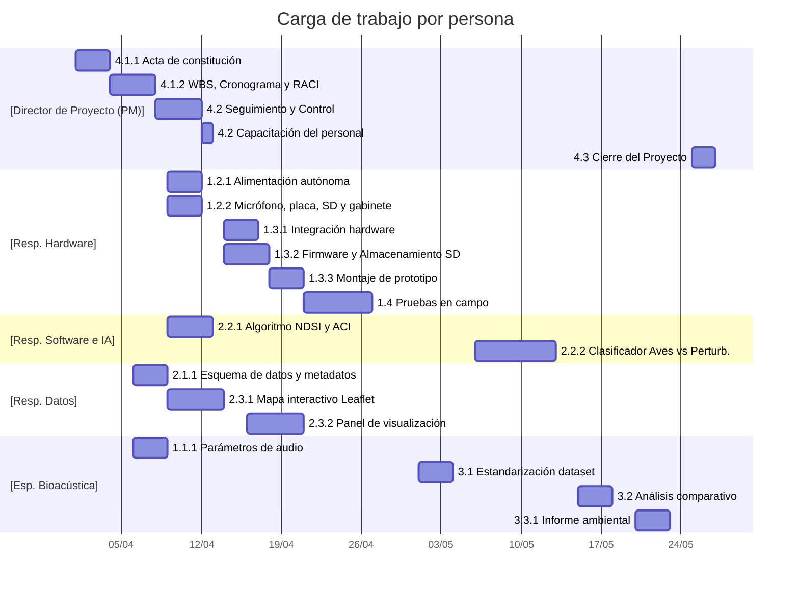

### ⚙️ Asignación de Recursos y Estimaciones Recalculadas
*Proyecto TRINO — Sistema de Monitoreo Bioacústico Autónomo | Cátedra Gestión de Proyectos (FIUNER)*

#### Perfil de recursos

| Persona | Rol | Disponibilidad (hs/sem) | Dedicación al proyecto |
| ------ | ------ | ------ | ------ |
| Integrante 1 | Director / Líder de Proyecto (PM) | 20 hs/sem | 30% (6 hs/sem prom.) |
| Integrante 2 | Responsable de Hardware e Infraestructura de Campo | 20 hs/sem | 40% (8 hs/sem prom.) |
| Integrante 3 | Responsable de Software e Inteligencia Artificial | 20 hs/sem | 50% (10 hs/sem prom.) |
| Integrante 4 | Especialista en Bioacústica y Asesor Ambiental | 20 hs/sem | 20% (4 hs/sem prom.) |
| Integrante 5 | Responsable de Datos y Visualización Web | 20 hs/sem | 30% (6 hs/sem prom.) |
| Integrante 6 | Responsable de Gestión de Calidad | 15 hs/sem | 20% (3 hs/sem prom.) |

---

#### Estimaciones recalculadas vs. Entrega 2

| ID | Tarea | Esfuerzo E2 (hs) | Persona asignada | Dedicación (%) | Duración E2 (días) | Duración E3 (días) | Δ Días | Justificación del cambio |
| ------ | ------ | ------ | ------ | ------ | ------ | ------ | ------ | ------ |
| **1.1.1** | Estandarización de parámetros de audio | 15 h | Esp. Bioacústica | 60% | 2.0 d | 3.0 d | +1.0 d | Especificación detallada de muestreo 48kHz 16-bit PCM y metadatos Audubon Core. |
| **1.2.1** | Sistema de alimentación autónomo | 15 h | Resp. Hardware | 70% | 2.5 d | 3.0 d | +0.5 d | Pruebas de dimensionamiento de panel solar 5W y batería LiFePO4 con BMS. |
| **1.2.2** | Micrófono, placa, SD, gabinete y soportes | 12 h | Resp. Hardware | 60% | 2.0 d | 3.0 d | +1.0 d | Adquisición e inspección de tarjeta SD High Endurance e intemperización IP65. |
| **1.3.1** | Integración de micrófono y placa comercial | 15 h | Resp. Hardware | 70% | 2.0 d | 3.0 d | +1.0 d | Calibración de ganancia del micrófono I2S INMP441 y ajuste del circuito. |
| **1.3.2** | Configuración de firmware y almacenamiento SD | 20 h | Resp. Hardware | 80% | 3.0 d | 4.0 d | +1.0 d | Recálculo por Riesgo R4: buffer en RAM y guardado cada 5 min contra corrupción. |
| **1.3.3** | Montaje y comprobación de funcionamiento | 12 h | Resp. Hardware | 60% | 2.0 d | 3.0 d | +1.0 d | Verificación de hermeticidad IP65 y test de disipación térmica en laboratorio. |
| **1.4** | Pruebas de autonomía y funcionamiento en campo | 35 h | Resp. Hardware | 75% | 5.0 d | 6.0 d | +1.0 d | Extensión del ensayo piloto a 72h continuas en el Jardín Botánico de Oro Verde. |
| **2.1.1** | Diseño de esquema de datos y metadatos | 18 h | Resp. Datos | 60% | 2.5 d | 3.0 d | +0.5 d | Modelado relacional en Supabase/PostgreSQL bajo el estándar Audubon Core. |
| **2.2.1** | Algoritmo de cálculo NDSI y ACI | 20 h | Resp. Software/IA | 70% | 3.0 d | 4.0 d | +1.0 d | Optimización FFT en Python para separación de bandas de biofonía y antropofonía. |
| **2.2.2** | Clasificador binario Aves vs. Perturbación | 40 h | Resp. Software/IA | 75% | 5.0 d | 7.0 d | +2.0 d | Mitigación Riesgo R3: filtrado espectral y aumento de datos de entrenamiento. |
| **2.3.1** | Mapa interactivo de puntos de muestreo | 25 h | Resp. Datos | 65% | 4.0 d | 5.0 d | +1.0 d | Desarrollo de capa geoespacial interactiva con Leaflet y OpenStreetMap. |
| **2.3.2** | Panel de visualización de indicadores | 30 h | Resp. Datos | 70% | 4.0 d | 5.0 d | +1.0 d | Integración de dashboard de tendencias biológicas para la Fundación CAUCE. |
| **3.1** | Estandarización del dataset acústico | 18 h | Esp. Bioacústica | 60% | 2.5 d | 3.0 d | +0.5 d | Curaduría y etiquetado manual de 300 muestras de audio de especies autóctonas. |
| **3.2** | Análisis comparativo zona conservada vs. urbana | 18 h | Esp. Bioacústica | 60% | 2.5 d | 3.0 d | +0.5 d | Evaluación estadística de diferencias en NDSI/ACI entre áreas de estudio. |
| **3.3.1** | Elaboración de informe ambiental para Sponsor | 20 h | Esp. Bioacústica / PM | 65% | 2.5 d | 3.0 d | +0.5 d | Consolidación de resultados bioacústicos para la Secretaría de Ambiente y ONG. |
| **4.1.1** | Acta de constitución y alcance | 15 h | Director de Proyecto | 50% | 2.0 d | 3.0 d | +1.0 d | Formalización de acuerdos, gobernanza y requerimientos institucionales. |
| **4.1.2** | WBS, Cronograma y RACI | 20 h | Director de Proyecto | 60% | 3.0 d | 4.0 d | +1.0 d | Estimación PERT con 95% de confianza y nivelación de responsabilidades. |
| **4.2.1** | Seguimiento y Control | 25 h | Director de Proyecto | 50% | 3.0 d | 4.0 d | +1.0 d | Control de avance físico (SPI/CPI) e informes semanales simplificados. |
| **4.2.2** | Capacitación del personal | 20 h | Director de Proyecto | 60% | 1.5 d | 1 d | +0.5 d | Control de funcionamiento final |
| **4.3** | Cierre del Proyecto | 8 h | Director de Proyecto | 50% | 1.5 d | 2.0 d | +0.5 d | Acta de aceptación final y transferencia tecnológica al Sponsor. |

---

#### Detección de sobreasignaciones

##### Sobreasignaciones detectadas

| Persona | Período conflictivo | Tareas en simultáneo | Carga total | Ajuste propuesto |
| ------ | ------ | ------ | ------ | ------ |
| **Responsable de Hardware** | 09/04 al 13/04 (Semana 2) | `1.2.1` (Alimentación) y `1.2.2` (Componentes y Gabinete) | 130% (26 h/sem) | Ejecutar secuencialmente `1.2.2` primero para definir dimensiones antes de finalizar la fuente de alimentación `1.2.1`. |
| **Responsable de Hardware** | 14/04 al 17/04 (Semana 3) | `1.3.1` (Integración HW) y `1.3.2` (Firmware y SD) | 150% (30 h/sem) | Secuenciar `1.3.1` los primeros 2 días y enfocar `1.3.2` en los 3 días siguientes; desplazar el inicio de `1.3.3` al 20/04. |
| **Responsable de Datos** | 16/04 al 22/04 (Semana 3-4) | `2.3.1` (Mapa interactivo) y `2.3.2` (Panel de visualización) | 135% (27 h/sem) | Reutilizar componentes de UI entre el mapa y el dashboard web, finalizando primero la API de datos `2.1.1`. |

--------------------------------------------------------------------------------

*Cátedra Gestión de Proyectos · FIUNER · 2026*
