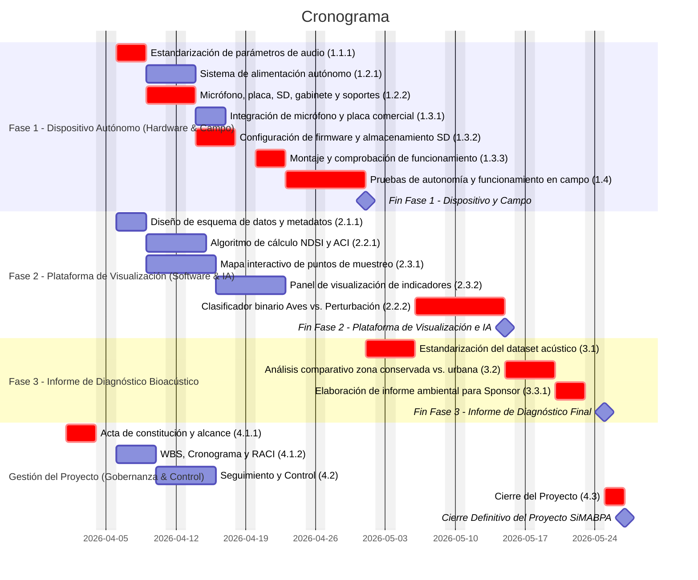

# 📅 Cronograma del Proyecto

## Diagrama de Gantt

## Tabla de tareas

| ID | Tarea | Predecesoras | Responsable | Duración (días) | Inicio | Fin | Hito |
|----|-------|-------------|------------|----------------|--------|-----|------|
| 4.1.1 | Acta de constitución y alcance | — | Director de Proyecto (PM) | 3 | 2026-04-01 | 2026-04-03 | No |
| 4.1.2 | WBS, Cronograma y RACI | 4.1.1 | Director de Proyecto (PM) | 4 | 2026-04-06 | 2026-04-09 | No |
| 1.1.1 | Estandarización de parámetros de audio | 4.1.1 | Especialista en Bioacústica | 3 | 2026-04-06 | 2026-04-08 | No |
| 1.2.1 | Sistema de alimentación autónomo | 1.1.1 | Responsable de Hardware | 3 | 2026-04-09 | 2026-04-13 | No |
| 1.2.2 | Micrófono, placa, SD, gabinete y soportes | 1.1.1 | Responsable de Hardware | 3 | 2026-04-09 | 2026-04-13 | No |
| 1.3.1 | Integración de micrófono y placa comercial | 1.2.1, 1.2.2 | Responsable de Hardware | 3 | 2026-04-14 | 2026-04-16 | No |
| 1.3.2 | Configuración de firmware y almacenamiento SD | 1.2.2 | Responsable de Hardware | 4 | 2026-04-14 | 2026-04-17 | No |
| 1.3.3 | Montaje y comprobación de funcionamiento | 1.3.1, 1.3.2 | Resp. Hardware e Infraestructura | 3 | 2026-04-20 | 2026-04-22 | No |
| 1.4 | Pruebas de autonomía y funcionamiento en campo | 1.3.3 | Resp. Hardware e Infraestructura | 6 | 2026-04-23 | 2026-04-30 | No |
| M1 | 🏁 Fin Fase 1 - Hardware y Campo | 1.4 | — | 0 | 2026-04-30 | 2026-04-30 | **Sí** |
| 2.1.1 | Diseño de esquema de datos y metadatos | 4.1.1 | Resp. Datos y Visualización | 3 | 2026-04-06 | 2026-04-08 | No |
| 2.2.1 | Algoritmo de cálculo NDSI y ACI | 1.1.1 | Responsable de Software e IA | 4 | 2026-04-09 | 2026-04-14 | No |
| 2.3.1 | Mapa interactivo de puntos de muestreo | 2.1.1 | Resp. Datos y Visualización | 5 | 2026-04-09 | 2026-04-15 | No |
| 2.3.2 | Panel de visualización de indicadores | 2.1.1, 2.2.1, 2.3.1 | Resp. Datos y Visualización | 5 | 2026-04-16 | 2026-04-22 | No |
| 2.2.2 | Clasificador binario Aves vs. Perturbación | 3.1 | Responsable de Software e IA | 7 | 2026-05-06 | 2026-05-14 | No |
| M2 | 🏁 Fin Fase 2 - Plataforma de Visualización e IA | 2.2.2, 2.3.2 | — | 0 | 2026-05-14 | 2026-05-14 | **Sí** |
| 3.1 | Estandarización del dataset acústico | 1.4 | Especialista en Bioacústica | 3 | 2026-05-01 | 2026-05-05 | No |
| 3.2 | Análisis comparativo zona conservada vs. urbana | 3.1, 2.2.1, 2.2.2 | Especialista en Bioacústica | 3 | 2026-05-15 | 2026-05-19 | No |
| 3.3.1 | Elaboración de informe ambiental para Sponsor | 3.2 | Especialista en Bioacústica / PM | 3 | 2026-05-20 | 2026-05-22 | No |
| M3 | 🏁 Fin Fase 3 - Informe de Diagnóstico Bioacústico | 3.3.1 | — | 0 | 2026-05-22 | 2026-05-22 | **Sí** |
| 4.2 | Seguimiento y Control | 4.1.2 | Director de Proyecto (PM) | 4 | 2026-04-10 | 2026-04-15 | No |
| 4.3 | Cierre del Proyecto | 1.4, 2.3.2, 3.3.1, 4.2 | Director de Proyecto (PM) | 2 | 2026-05-25 | 2026-05-26 | No |
| M4 | 🏁 Cierre Definitivo del Proyecto | 4.3 | — | 0 | 2026-05-26 | 2026-05-26 | **Sí** |

---
### Duración Total del Proyecto

* **En horas netas continuas (CPM exacto):** La suma exacta de la ruta crítica es de **297.8 horas** (\~**37.23 días hábiles**).
* **En días redondeados de trabajo directo:** La suma de los días enteros sobre el camino crítico asciende a **40 días hábiles**.
* **En el Cronograma Gantt (Cobertura Temporal):** La **duración total figura en 43 días**. Esta diferencia incluye la ventana de días no laborables (como feriados o días de descanso) dentro del calendario del proyecto
---
*Cátedra Gestión de Proyectos · FIUNER · 2026*
