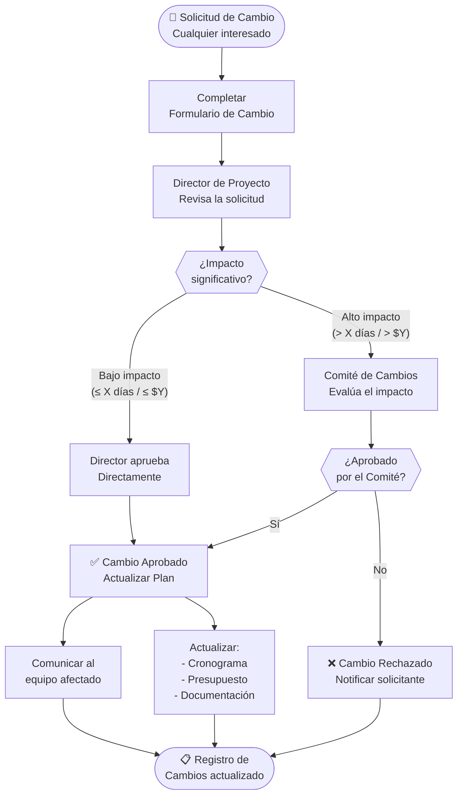

# 🔄 Gestión de Cambios

## Circuito de cambios

## 👥 2. Roles en la Gestión de Cambios

| Rol en la Gestión de Cambios | Integrante / Entidad | Responsabilidades y Autoridad |
|:---|:---|:---|
| **Solicitante del Cambio** | Integrantes del equipo (PM, HW, SW, BIO, DAT), Sponsor o Usuarios Clave | Identifica la necesidad de mejora y completa el Formulario Estándar de Solicitud de Cambio (CRF). No posee autoridad de aprobación. |
| **Analista de Impacto Técnico** | Responsable del Área afectada (HW: Santiago Junquera, SW: Fátima Luna, BIO: Asesor, DAT: Resp. Datos) | Evalúa la factibilidad técnica, cuantifica el impacto en horas/insumos y emite un dictamen técnico recomendatorio. |
| **Director de Proyecto (PM)** | Guerrero, Jerónimo | Registra solicitudes en la Bitácora y posee autoridad ejecutiva para aprobar cambios Nivel 1 y 2. |
| **Comité de Control de Cambios (CCB)** | Comité Integrado (PM, HW, SW, BIO, DAT) | Evalúa colegiadamente las solicitudes Nivel 2 y aprueba o rechaza por mayoría simple según el balance beneficio-costo-riesgo. |
| **Patrocinador / Sponsor Estatal** | Secretaría de Ambiente de Entre Ríos / CAUCE | Evalúa y autoriza cambios estratégicos Nivel 3 que modifiquen el presupuesto global, el alcance principal o el plazo comercial. |
| **Responsable de Implementación** | Integrante asignado según Matriz RACI | Ejecuta las modificaciones aprobadas en los entregables correspondientes, actualiza repositorios y notifica la finalización. |

---

## 🎯 3. Criterios de Aprobación de Cambios

| Nivel de Impacto | Criterios y Umbrales de Impacto | Autoridad y Criterio de Aprobación |
|:---|:---|:---|
| **Nivel 1: Cambio Menor (Bajo Impacto)** | Impacto menor a 1 día (absorbible en holgura libre), $0 costo adicional, sin modificación de WBS ni degradación de la estanqueidad IP65. | **Responsable de Área + PM:** Aprobación directa si optimiza la ejecución técnica o mejora el diseño sin afectar otras áreas. |
| **Nivel 2: Cambio Moderado (Medio Impacto)** | Impacto de 1 a 3 días (absorbible en contingencia PERT), costo adicional < 10% en insumos, reajustes en WBS Nivel 3. | **Comité de Control de Cambios (CCB):** Aprobación por mayoría si previene riesgos mayores (IA/SD) sin alterar el plazo comercial. |
| **Nivel 3: Cambio Mayor (Alto Impacto)** | Impacto > 5 días (supera plazo PERT de 45 días), aumento presupuestario > 10% o alteración de Entregables Principales / exclusiones. | **Sponsor Estatal + PM:** Aprobación institucional formal mediante evaluación financiera, addendum y asignación de fondos/plazo. |
| **Veto / Rechazo Inmediato** | Solicitudes informales sin CRF, violaciones de exclusiones sin financiamiento, o cambios que arriesguen la estanqueidad IP65 o la entrega. | **PM / CCB / Sponsor:** Rechazo obligatorio e inmediato sin análisis en profundidad, registrando la causa en la Bitácora. |

---

## Registro de cambios

> Ver plantilla: [`/plantillas/formulario-cambio.md`](../../plantillas/formulario-cambio.md)

| # | Fecha | Descripción del cambio | Solicitante | Estado | Impacto |
|---|-------|------------------------|------------|:------:|---------|
| CC-001 | [COMPLETAR] | [COMPLETAR] | [COMPLETAR] | ✅ Aprobado | [COMPLETAR] |

---

*Cátedra Gestión de Proyectos · FIUNER · 2026*
