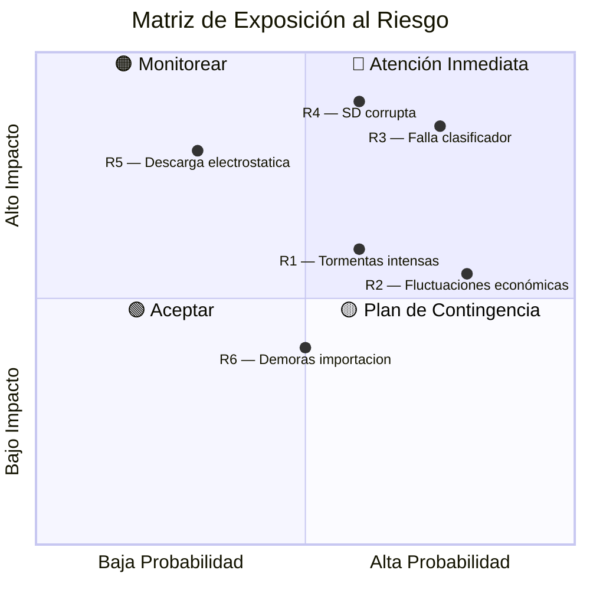

# 📊 Matriz de Exposición al Riesgo

## Visualización

> **Cómo leer el gráfico:** cada punto representa un riesgo. El eje X es la probabilidad normalizada (valor/10) y el eje Y es el impacto normalizado (valor/10).

## Interpretación

| Cuadrante | Zona | Riesgos | Acción |
|-----------|------|---------|--------|
| Superior derecho | 🔴 Atención Inmediata | R1, R2, R3 y R4 | Mitigar o evitar activamente |
| Superior izquierdo | 🟠 Monitorear | R5 | Planificar contingencia |
| Inferior derecho | 🟡 Contingencia |  | Transferir o aceptar con plan |
| Inferior izquierdo | 🟢 Aceptar | R6 | Registrar y monitorear |

---

*Cátedra Gestión de Proyectos · FIUNER · 2026*
