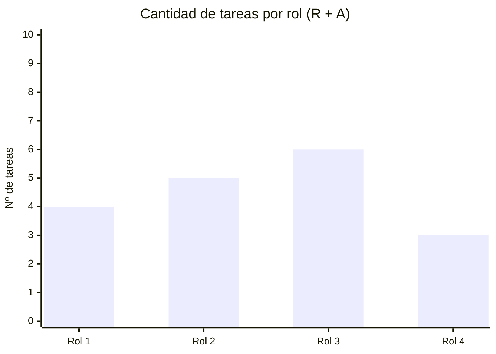

# 👥 Matriz RACI

> **R** = Responsable (ejecuta) · **A** = Aprobador (único por tarea) · **C** = Consultado · **I** = Informado

## Roles del proyecto

| Rol | Persona asignada |
|-----|-----------------|
| Director / Líder de Proyecto (PM)| [COMPLETAR] |
| Responsable de Hardware e Infraestructura de Campo | [COMPLETAR] |
| Responsable de Software e IA | [COMPLETAR] |
| Especialista en Bioacústica y Conservación/Especialista en Biodiversidad / Asesor ambiental | [COMPLETAR] |
| Responsable de Datos y Visualización | [COMPLETAR] |

## Matriz

| ID | Tarea | Director | Responsable de Hardware | Responsable de Software | Especialista en Bioacústica | Responsable de Datos |
|----|-------|:-------:|:-------:|:-------:|:-------:|:-------:|
| 1.1 | [COMPLETAR] | A | R | I | I | I |
| 1.2 | [COMPLETAR] | A | R | C | I | I |
| 1.3 | [COMPLETAR] | A | C | R | I | I |
| 2.1 | [COMPLETAR] | A | R | R | I | I |
| 2.2 | [COMPLETAR] | A | C | R | C | I |
| 2.3 | [COMPLETAR] | A | I | R | R | I |
| 3.1 | [COMPLETAR] | A | C | R | R | I |
| 3.2 | [COMPLETAR] | A | I | C | R | I |

> ⚠️ **Verificación obligatoria:** cada fila debe tener exactamente **1 A** y al menos **1 R**.

## Análisis de carga de responsabilidades

> [COMPLETAR: analizar si hay roles sobrecargados o con pocas responsabilidades y cómo se equilibra]

---

*Cátedra Gestión de Proyectos · FIUNER · 2026*
