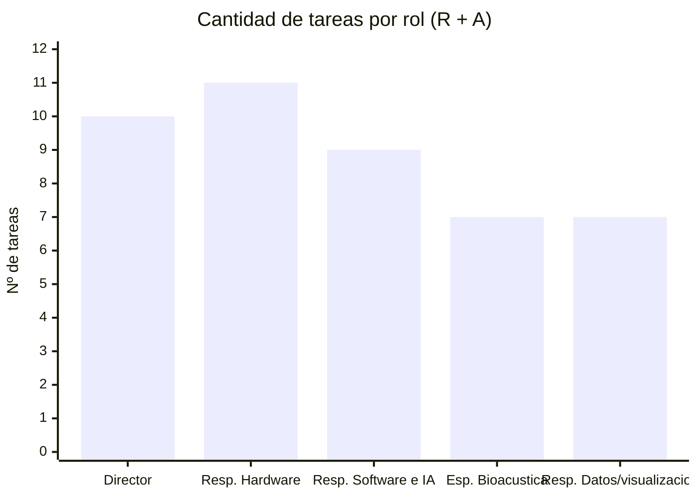

# 👥 Matriz RACI

> **R** = Responsable (ejecuta) · **A** = Aprobador (único por tarea) · **C** = Consultado · **I** = Informado

## Roles del proyecto

| Rol | Persona asignada |
|-----|-----------------|
| Director / Líder de Proyecto (PM)| [COMPLETAR] |
| Responsable de Hardware e Infraestructura de Campo | [COMPLETAR] |
| Responsable de Software e IA | [COMPLETAR] |
| Especialista en Bioacústica y Conservación/Especialista en Biodiversidad / Asesor ambiental | [COMPLETAR] |
| Responsable de Datos y Visualización | [COMPLETAR] |
| Gestión de Calidad | [COMPLETAR] |
| Sponsor | [COMPLETAR] |

## Matriz

| ID | Tarea | Director | Responsable de Hardware | Responsable de Software | Especialista en Bioacústica | Responsable de Datos | Gestión de Calidad | Sponsor
|----|-------|:-------:|:-------:|:-------:|:-------:|:-------:|:-------:|:-------:|
| 1.1 | Estandarización de parámetros de audio | I | C | R | R | C | A |  |
| 1.2.1 | Sistema de alimentación autónomo | I | R | C |  |  | A |  |
| 1.2.2 | Micrófono, placa, SD, gabinete y soportes | I | R | C |  |  | A |  |
| 1.3.1 | Integración de micrófono y placa comercial | I | R | R |  |  | A |  |
| 1.3.2 | Configuración de firmware y almacenamiento SD | I | R | R |  | C | A |  |
| 1.3.3 | Montaje y comprobación de funcionamiento | I | R | C |  |  | A |  |
| 1.4 | Pruebas de autonomía y funcionamiento en campo | I | R | I | R | C | A |  |
| 2.1.1 | Diseño de esquema de datos y metadatos | I |  | C | C | R | A |  |
| 2.2.1 | Algoritmo de cálculo NDSI y ACI | I |  | R | C | C | A |  |
| 2.2.2 | Clasificador binario Aves vs Perturbación | I |  | R | C | I | A |  |
| 2.3.1 | Mapa interactivo de puntos de muestreo| I |  | C | C | R | A |  |
| 2.3.2 | Panel de visualización de indicadores | I |  | I | C | R | A |  |
| 3.1 | Estandarización del dataset acústico | I |  | C | R | C | A |  |
| 3.2 | Análisis comparativo zona conservada vs urbana | I | I | C | R | R | A |  |
| 3.3.1 | Elaboración de informe ambiental para el Sponsor | R |  |  | R | C | A |  |
| 4.1.1 | Acta de constitución y alcance | R | C | C | C | C |  | A |
| 4.1.2 | WBS, cronograma y RACI | R | C | C | C | C | A |  |
| 4.2 | Seguimiento y control | R | I | I | I | I | A |  |
| 4.3 | Cierre | R | I | I | I | I |  | A |

> ⚠️ **Verificación obligatoria:** cada fila debe tener exactamente **1 A** y al menos **1 R**.

## Análisis de carga de responsabilidades

La matriz logra un equilibrio funcional dinámico: no existe solapamiento excesivo de ejecución primaria ($R$) en un mismo hito temporal para ningún perfil. La co-responsabilidad en tareas complejas (como la integración firmware/hardware en 1.3 o la elaboración del informe final en 3.3) previene cuellos de botella y promueve el trabajo interdisciplinario.

---

*Cátedra Gestión de Proyectos · FIUNER · 2026*
