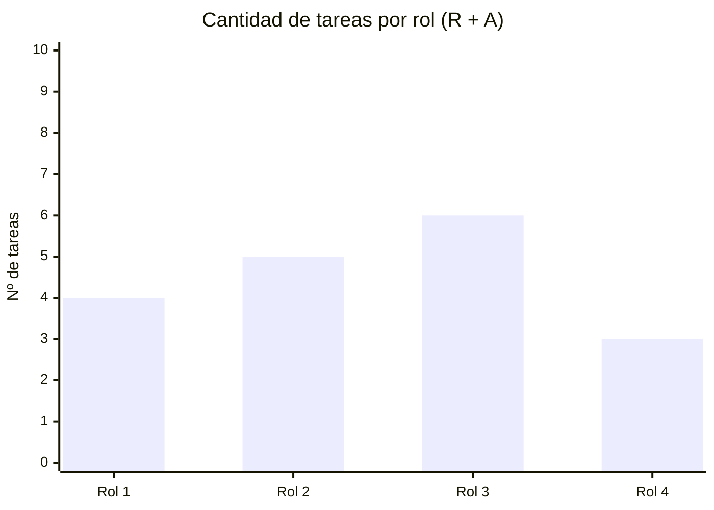

# 👥 Matriz RACI

> **R** = Responsable (ejecuta) · **A** = Aprobador (único por tarea) · **C** = Consultado · **I** = Informado

## Roles del proyecto

| Rol | Persona asignada |
|-----|-----------------|
| Director / Líder de Proyecto (PM)| [COMPLETAR] |
| Responsable de Hardware e Infraestructura de Campo | [COMPLETAR] |
| Responsable de Software e IA | [COMPLETAR] |
| Especialista en Bioacústica y Conservación/Especialista en Biodiversidad / Asesor ambiental | [COMPLETAR] |
| Responsable de Datos y Visualización | [COMPLETAR] |

## Matriz

| ID | Tarea | Director | Responsable de Hardware | Responsable de Software | Especialista en Bioacústica | Responsable de Datos |
|----|-------|:-------:|:-------:|:-------:|:-------:|:-------:|
| 1.1 | Estandarización de parámetros de audio | I | | C | R | A | C |
| 1.2 | Sistema de alimentación autónomo y selección de hardware (micrófono, placa, SD, gabinete y soportes) | A | R | C | I | I |
| 1.3 | Integración de componentes, configuración de firmware/SD y montaje del dispositivo | A | R | R | | I | C |
| 1.4 | Pruebas de autonomía y funcionamiento en campo | A | R | I | R | C |
| 2.1 | Diseño de esquema de datos y metadatos | A | I | C | C | R |
| 2.2 | Algoritmo de cálculo NDSI y ACI y clasificador binario Aves vs Perturbación | A | I | R | C | R |
| 2.3 | Mapa interactivo de puntos de muestreo y panel de visualización de indicadores | A | I | R | C | R |
| 3.1 | Estandarización del dataset acústico | A | I | C | R | R |
| 3.2 | Análisis comparativo zona conservada vs urbana | A | I | I | R | C |
| 3.3 | Elaboración de informe ambiental para el Sponsor | A | I | I | R | R |
| 4.1 | Acta de constitución y alcance; WBS, cronograma y RACI | A/R | C | C | C | C |
| 4.2 | Seguimiento y control | A | R | R | R | R |
| 4.3 | Cierre | R | I | I | I | I |

> ⚠️ **Verificación obligatoria:** cada fila debe tener exactamente **1 A** y al menos **1 R**.

## Análisis de carga de responsabilidades

> [COMPLETAR: analizar si hay roles sobrecargados o con pocas responsabilidades y cómo se equilibra]

---

*Cátedra Gestión de Proyectos · FIUNER · 2026*
